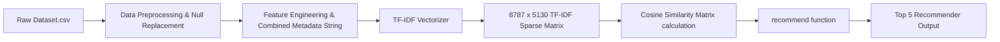

# 🎬 Task 1: Netflix Content Recommendation System

[](https://www.python.org/)
[](https://scikit-learn.org/)
[](https://pandas.pydata.org/)
[](#license)

An end-to-end **Content-Based Recommendation System** designed to analyze Netflix titles (Movies and TV Shows) and deliver highly accurate, personalized content recommendations using **Natural Language Processing (NLP)**, **TF-IDF Vectorization**, and **Cosine Similarity**.

---

## 📌 Internship Portfolio & Task Navigation

This repository is part of my **Auspify AI / Machine Learning Internship**. All 4 internship tasks are organized within dedicated subdirectories:

| Task # | Task Title | Status |
| :---: | :--- | :---: |
| **Task 1** | **Netflix Content Recommendation System** | ✅ Completed |
| **Task 2** | Coming Soon... | ⏳ |
| **Task 3** | Coming Soon... | ⏳ |
| **Task 4** | Coming Soon... | ⏳ |

### 👤 Author & GitHub Profile
- **Developer**: **Muhammad Haseeb Ahmed**
- **Company**: **Auspify Technologies** (AI / ML Internship)
- **GitHub Profile**: [github.com/haseebahmed9814-design](https://github.com/haseebahmed9814-design)
- **Internship Repository**: [github.com/haseebahmed9814-design/Auspify-AI-Internship-Tasks](https://github.com/haseebahmed9814-design/Auspify-AI-Internship-Tasks)

---

## 📌 Project Overview

With thousands of titles available on streaming platforms like Netflix, content discovery is critical for user engagement. This project builds a content-based filtering model that recommends similar movies and TV shows based on key metadata attributes:
- **Genres & Categories** (`listed_in`)
- **Content Type** (`Movie` vs `TV Show`)
- **Country of Origin** (`country`)
- **Age Ratings** (`rating`)
- **Directors** (`director`)

By engineering a combined feature space and applying vector similarity metrics, the system calculates pairwise affinity scores across the entire Netflix library to present the **Top-N most relevant recommendations** for any selected title.

---

## 🚀 Key Features & Highlights

- **Data Wrangling & Hidden Null Detection**: Handled disguised missing values (`"Not Given"`) in key columns like `director` (2,588 entries) and `country` (287 entries) without losing catalog rows.
- **Text Preprocessing & Token Engineering**: Formatted text attributes with lowercase normalization, whitespace handling, and multi-word token joining (e.g., `tv_dramas`, `united_states`, `kirsten_johnson`).
- **Feature Weighting**: Amplified high-signal attributes (such as genres) within the combined text representation for higher recommendation relevance.
- **TF-IDF Vector Space Analysis**: Generated a 5,130-dimensional sparse feature matrix for 8,787 clean dataset titles using custom whitespace tokenization (`token_pattern=r"\S+"`).
- **Cosine Similarity Engine**: Computed an $8,787 \times 8,787$ similarity matrix for instant title query lookups.
- **Interactive Title Search & Fallback**: User input query lookup system supporting case-insensitive searching and partial title match suggestions when an exact title is not found.
- **Rigorous Evaluation Metric**: Validated recommendation quality across 200 random titles, achieving a **98.4% Genre Match Rate** and **99.9% Type Precision**.

---

## 📁 Repository Structure

```directory
Task_01/
├── Dataset.csv                       # Netflix titles raw metadata dataset (8,790 rows)
├── Task01.ipynb                      # Complete Jupyter Notebook (EDA, Data Cleaning, TF-IDF, Recommendation Engine & Testing)
├── screenshots/                      # Step-by-step execution screenshots (11 images)
│   ├── Screenshot 2026-10-08 222403.png
│   └── ...
├── .gitignore                        # Git ignore rules for checkpoints and cache
├── requirements.txt                  # Python dependency requirements
└── README.md                         # Project documentation
```

---

## 📸 Execution Proof & Visual Gallery

| Data Cleaning & Processing | EDA - Content Distribution |
| :---: | :---: |
|  |  |

| Model Execution & Testing | Accuracy & Quality Evaluation |
| :---: | :---: |
|  |  |


---

## 📊 Exploratory Data Analysis (EDA) & Insights

1. **Content Type Distribution**:
   - **Movies**: 6,124 titles (~69.7%)
   - **TV Shows**: 2,663 titles (~30.3%)
2. **Dominant Ratings**:
   - High prevalence of mature content rated `TV-MA` (3,205 titles) and `TV-14` (2,157 titles), followed by `TV-PG` (861 titles) and `R` (799 titles).
3. **Top Genres**:
   - Leading categories include *Dramas*, *International Movies*, *Documentaries*, *Comedies*, *Action & Adventure*, and *Kids' TV*.

---

## 🛠️ Data Pipeline & Methodology



### 1. Data Cleaning
- Replaced placeholder values (`"Not Given"`, `"N/A"`, `"Unknown"`) with standard `NaN` and imputed empty strings for string concatenation.
- Deduplicated identical entries (reduced dataset from 8,790 to 8,787 unique titles).
- Reset DataFrame indices to maintain strict alignment with vector matrices.

### 2. Feature Combination
Concatenated cleaned attributes into a single feature string per title:
$$\text{Combined Text} = \text{Type} + (\text{Genres} \times 2) + \text{Country} + \text{Rating} + \text{Director}$$

### 3. Vectorization & Similarity
- **TF-IDF Matrix**:
  ```python
  tfidf = TfidfVectorizer(token_pattern=r"\S+")
  tfidf_matrix = tfidf.fit_transform(df_clean["combined"])
  # Matrix shape: (8787, 5130)
  ```
- **Cosine Similarity**:
  $$\text{Similarity}(A, B) = \frac{A \cdot B}{\|A\| \|B\|}$$

---

## 📈 Evaluation & Performance

An automated quality evaluator function tested recommendations across a random sample of 200 titles:

| Evaluation Metric | Score | Description |
| :--- | :---: | :--- |
| **Genre Hit Rate** | **98.4%** | Share of top-5 recommendations matching at least one original genre tag |
| **Content Type Precision** | **99.9%** | Share of top-5 recommendations matching exact content type (Movie/TV Show) |

---

## 💻 Usage & Demo

### Running the Recommendation Engine

```python
from sklearn.feature_extraction.text import TfidfVectorizer
from sklearn.metrics.pairwise import cosine_similarity
import pandas as pd

# Core Recommendation Function
def recommend(title, n=5):
    index = df_clean[df_clean["title"] == title].index[0]
    scores = similarity[index]
    top = [i for i in scores.argsort()[::-1] if i != index][:n]
    result = df_clean.iloc[top][["title", "type", "listed_in"]].copy()
    result["score"] = scores[top].round(2)
    return result
```

### Interactive Title Search & Recommendation Lookup

```python
# User Input Search with Partial Match Fallback
name = input("Enter a Netflix title: ").strip().lower()
matches = df_clean[df_clean["title"].str.lower() == name]

if len(matches) == 0:
    close = df_clean[df_clean["title"].str.lower().str.contains(name, regex=False)]["title"].head(5).tolist()
    print("Title not found.")
    if close:
        print("Did you mean:", close)
else:
    display(recommend(matches.iloc[0]["title"]))
```

### Sample Recommendations

#### 🟢 Query: `"Ganglands"` (TV Show | Crime, International, Action)
| Title | Type | Genres | Match Score |
| :--- | :---: | :--- | :---: |
| **Crime Time** | TV Show | Crime TV Shows, International TV Shows, TV Action | `0.86` |
| **Lupin** | TV Show | Crime TV Shows, International TV Shows, TV Action | `0.86` |
| **Fatal Destiny** | TV Show | Crime TV Shows, International TV Shows, TV Action | `0.79` |
| **Agent Raghav** | TV Show | Crime TV Shows, International TV Shows, TV Action | `0.78` |
| **Smoking** | TV Show | Crime TV Shows, International TV Shows, TV Action | `0.78` |

#### 🟢 Query: `"Midnight Mass"` (TV Show | Horror, Dramas, Mysteries)
| Title | Type | Genres | Match Score |
| :--- | :---: | :--- | :---: |
| **Ratched** | TV Show | TV Dramas, TV Horror, TV Mysteries | `0.90` |
| **The Haunting of Hill House** | TV Show | TV Dramas, TV Horror, TV Mysteries | `0.90` |
| **The Haunting of Bly Manor** | TV Show | TV Dramas, TV Horror, TV Mysteries | `0.90` |
| **Brand New Cherry Flavor** | TV Show | TV Dramas, TV Horror, TV Mysteries | `0.90` |

#### 🟢 Query: `"Zindagi Gulzar Hai"` (TV Show | Romantic, International, TV Dramas)
| Title | Type | Genres | Match Score |
| :--- | :---: | :--- | :---: |
| **In Laws** | TV Show | International TV Shows, Romantic TV Shows, TV Dramas | `1.00` |
| **Cinta Iris** | TV Show | International TV Shows, Romantic TV Shows, TV Dramas | `1.00` |
| **Humsafar** | TV Show | International TV Shows, Romantic TV Shows, TV Dramas | `1.00` |
| **Dérè: An African Tale** | TV Show | International TV Shows, Romantic TV Shows, TV Dramas | `1.00` |
| **Behind the Newsroom** | TV Show | International TV Shows, Romantic TV Shows, TV Dramas | `0.96` |

#### 🟢 Query: `"Laws of Attraction"` (TV Show | Romantic, International, TV Comedies)
| Title | Type | Genres | Match Score |
| :--- | :---: | :--- | :---: |
| **Hometown Cha-Cha-Cha** | TV Show | International TV Shows, Romantic TV Shows, TV Comedies | `1.00` |
| **แผนร้ายนายเจ้าเล่ห์** | TV Show | International TV Shows, Romantic TV Shows, TV Comedies | `1.00` |
| **Secret of Success** | TV Show | International TV Shows, Romantic TV Shows, TV Comedies | `1.00` |
| **Love Storm** | TV Show | International TV Shows, Romantic TV Shows, TV Comedies | `1.00` |
| **The Perfect Match** | TV Show | International TV Shows, Romantic TV Shows, TV Comedies | `1.00` |

---

## ⚙️ Setup & Installation

1. **Clone the repository / Navigate to directory**:
   ```bash
   cd Task_01
   ```

2. **Install Required Python Packages**:
   ```bash
   pip install -r requirements.txt
   ```

3. **Launch Jupyter Notebook**:
   ```bash
   jupyter notebook Task01.ipynb
   ```

---

## 🔮 Future Enhancements

- [ ] **Streamlit / Web UI Application**: Build an interactive web dashboard for real-time title search and recommendation rendering.
- [ ] **Plot Description Semantic Embedding**: Incorporate BERT / Sentence-Transformers on plot synopses to capture deeper semantic storyline similarities.
- [ ] **Collaborative & Hybrid Filtering**: Integrate user ratings and watch history to construct a hybrid recommendation model.

---

## 📜 License

Distributed under the MIT License. Feel free to use, modify, and distribute this project.
