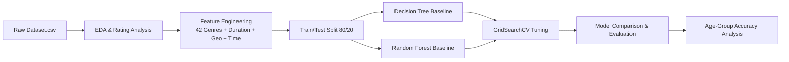

# 🎯 Task 2: Netflix Audience Rating Classification

[](https://www.python.org/)
[](https://scikit-learn.org/)
[](https://pandas.pydata.org/)
[](#license)

A complete **Multi-Class Classification** pipeline that predicts Netflix content audience rating categories (`TV-Y`, `TV-PG`, `TV-14`, `TV-MA`, `R`, `PG-13`, etc.) from available content metadata using **Decision Tree** and **Random Forest** classifiers with hyperparameter tuning.

---

## 📌 Internship Portfolio & Task Navigation

This repository is part of my **Auspify AI / Machine Learning Internship**. All 4 internship tasks are organized within dedicated subdirectories:

| Task # | Task Title | Status |
| :---: | :--- | :---: |
| **Task 1** | Netflix Content Recommendation System | ✅ Completed |
| **Task 2** | **Netflix Audience Rating Classification** | ✅ Completed |
| **Task 3** | Netflix Viewership Trend Forecasting | ✅ Completed |
| **Task 4** | Netflix Content Audience Segmentation | ✅ Completed |

### 👤 Author & GitHub Profile
- **Developer**: **Muhammad Haseeb Ahmed**
- **Company**: **Auspify Technologies** (AI / ML Internship)
- **GitHub Profile**: [github.com/haseebahmed9814-design](https://github.com/haseebahmed9814-design)
- **Internship Repository**: [github.com/haseebahmed9814-design/Auspify-AI-Internship-Tasks](https://github.com/haseebahmed9814-design/Auspify-AI-Internship-Tasks)

---

## 📌 Project Overview

Netflix uses audience rating labels (TV-MA, PG-13, R, TV-14, etc.) to guide viewers toward appropriate content. This task builds a supervised machine learning pipeline that automatically classifies the audience rating of any Netflix title based on its metadata attributes — without relying on the rating label itself.

The pipeline covers the full ML workflow:
- **Exploratory Data Analysis (EDA)** on rating category distributions
- **Advanced Feature Engineering**: 42 genre one-hot features, dual duration decomposition, temporal and geographical signals
- **Class Imbalance Handling** using `class_weight='balanced'`
- **Model Training & Comparison**: Decision Tree vs Random Forest (baseline and tuned)
- **Hyperparameter Optimization** with `GridSearchCV`
- **Performance Evaluation**: Accuracy, Classification Reports, Confusion Matrices

---

## 🚀 Key Features & Highlights

- **42-Genre One-Hot Encoding**: All Netflix genres extracted and binary-encoded as individual features.
- **Dual Duration Decomposition**: Separate `duration_minutes` (Movies) and `duration_seasons` (TV Shows) features extracted from a single mixed column.
- **Temporal Signals**: Release year, content age, and decade-of-release features to capture rating trend shifts.
- **Geographical Signal**: Top-20 countries encoded as categorical features.
- **Class Imbalance Mitigation**: Balanced class weights applied to handle skewed rating distributions.
- **Regulatory Rating Grouping**: Mapped equivalent ratings (e.g., `R` ≡ `TV-MA`) into standardized age-group buckets for secondary evaluation.

---

## 📁 Repository Structure

```directory
Task_02/
├── Dataset.csv                       # Netflix titles raw metadata dataset (8,790 rows)
├── Task02.ipynb                      # Complete Jupyter Notebook (EDA, Feature Engineering, Model Training & Evaluation)
├── screenshots/                      # Step-by-step execution screenshots (18 images)
│   ├── Screenshot 2026-10-13 020419.png
│   └── ...
├── requirements.txt                  # Python dependency requirements
└── README.md                         # Project documentation
```

---

## 📸 Execution Proof & Visual Gallery

| Rating Distribution (EDA) | Feature Correlation Heatmap |
| :---: | :---: |
|  |  |

| Decision Tree Confusion Matrix | Random Forest Confusion Matrix |
| :---: | :---: |
|  |  |

---

## 📊 Workflow & Methodology



### 1. Feature Engineering
| Feature Group | Features Created |
| :--- | :--- |
| Genre Encoding | 42 binary genre columns (e.g., `genre_Dramas`, `genre_Comedies`) |
| Duration | `duration_minutes` (Movies), `duration_seasons` (TV Shows) |
| Temporal | `release_year`, `content_age`, `release_decade` |
| Content Type | Binary `is_movie` flag |
| Geography | Top-20 countries as categorical encoded features |

### 2. Model Training
```python
# Decision Tree Baseline
dt_model = DecisionTreeClassifier(class_weight='balanced', random_state=42)

# Random Forest Baseline
rf_model = RandomForestClassifier(n_estimators=100, class_weight='balanced', random_state=42)

# Hyperparameter Tuning with GridSearchCV
param_grid = {
    'n_estimators': [100, 200],
    'max_depth': [10, 20, None],
    'min_samples_split': [2, 5, 10]
}
```

---

## 📈 Evaluation & Performance

### Model Comparison Results

| Model | Test Accuracy |
| :--- | :---: |
| **Random Forest (Tuned)** | **57.51%** |
| Random Forest (Baseline) | 55.92% |
| Decision Tree (Tuned) | 52.05% |
| Decision Tree (Baseline) | 46.53% |

### Best Model Summary

The **Tuned Random Forest** achieved the highest test accuracy of **57.51%** among all four evaluated models:
- **Weighted F1-Score**: 0.55
- **Macro F1-Score**: 0.46
- **Age-Group Accuracy** (grouping equivalent ratings like R/TV-MA): **~65% (64.96%)**

> **Note**: Multi-class rating classification is inherently challenging due to subjective rating assignments across different regulatory bodies. The ~65% age-group accuracy represents meaningful signal extraction.

---

## ⚙️ Setup & Installation

1. **Navigate to directory**:
   ```bash
   cd Task_02
   ```

2. **Install Required Python Packages**:
   ```bash
   pip install -r requirements.txt
   ```

3. **Launch Jupyter Notebook**:
   ```bash
   jupyter notebook Task02.ipynb
   ```

---

## 🔮 Future Enhancements

- [ ] **NLP on Descriptions**: Incorporate TF-IDF or BERT embeddings from plot descriptions to improve accuracy.
- [ ] **XGBoost / LightGBM**: Evaluate gradient-boosted ensemble models for potential accuracy gains.
- [ ] **SMOTE Oversampling**: Apply synthetic minority oversampling to further address class imbalance.

---

## 📜 License

Distributed under the MIT License. Feel free to use, modify, and distribute this project.
