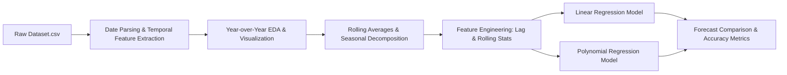

# 📈 Task 3: Netflix Viewership Trend Forecasting

[](https://www.python.org/)
[](https://scikit-learn.org/)
[](https://pandas.pydata.org/)
[](#license)

A comprehensive **Time Series Analysis & Content Trend Forecasting** project that analyzes historical Netflix catalog growth patterns, identifies release trends by genre/type/country, and forecasts future content volume using regression models.

---

## 📌 Internship Portfolio & Task Navigation

This repository is part of my **Auspify AI / Machine Learning Internship**. All 4 internship tasks are organized within dedicated subdirectories:

| Task # | Task Title | Status |
| :---: | :--- | :---: |
| **Task 1** | Netflix Content Recommendation System | ✅ Completed |
| **Task 2** | Netflix Audience Rating Classification | ✅ Completed |
| **Task 3** | **Netflix Viewership Trend Forecasting** | ✅ Completed |
| **Task 4** | Netflix Content Audience Segmentation | ✅ Completed |

### 👤 Author & GitHub Profile
- **Developer**: **Muhammad Haseeb Ahmed**
- **Company**: **Auspify Technologies** (AI / ML Internship)
- **GitHub Profile**: [github.com/haseebahmed9814-design](https://github.com/haseebahmed9814-design)
- **Internship Repository**: [github.com/haseebahmed9814-design/Auspify-AI-Internship-Tasks](https://github.com/haseebahmed9814-design/Auspify-AI-Internship-Tasks)

---

## 📌 Project Overview

Understanding how Netflix's content library evolves over time is critical for content strategy decisions. This task performs **time-series trend analysis** on Netflix catalog data, studying the growth patterns of Movies and TV Shows over the years across genres, countries, and rating categories — and builds **regression-based forecasting models** to predict future content volume.

---

## 🚀 Key Features & Highlights

- **Temporal EDA**: Year-over-year content addition analysis by type, genre, and geography.
- **Rolling Averages**: Smoothed trend lines to identify long-term growth patterns vs. short-term noise.
- **Seasonal Decomposition**: Decomposed time-series signals into trend, seasonality, and residual components.
- **Regression Forecasting**: Linear Regression and Polynomial Regression models trained on historical release year data.
- **Multi-Category Forecasting**: Independent forecasting models built for Movies vs TV Shows.
- **Feature Engineering**: Lag features, rolling statistics, and categorical trend encodings.
- **Visualization Suite**: Rich matplotlib/seaborn plots including heatmaps, line charts, bar plots, and decomposition subplots.

---

## 📁 Repository Structure

```directory
Task_03/
├── Dataset.csv                       # Netflix titles raw metadata dataset (8,790 rows)
├── Task_03.ipynb                     # Complete Jupyter Notebook (EDA, Trend Analysis, Forecasting)
├── screenshots/                      # Step-by-step execution screenshots (18 images)
│   ├── Screenshot 2026-10-13 020419.png
│   └── ...
└── README.md                         # Project documentation
```

---

## 📸 Execution Proof & Visual Gallery

| Content Growth Over Time | Genre Trend Heatmap |
| :---: | :---: |
|  |  |

| Forecasting Model Output | Seasonal Decomposition |
| :---: | :---: |
|  |  |

---

## 📊 Workflow & Methodology



### 1. Temporal Feature Extraction
- Parsed `date_added` column to extract `year_added` and `month_added`
- Grouped content by release year and addition year to track catalog growth
- Separated Movies and TV Shows for independent trend tracking

### 2. Trend Analysis
- **Year-over-Year Growth**: Annual content addition counts from 2008–2021
- **Genre Trends**: Top 10 genres tracked over time via pivot-table heatmaps
- **Country Contributions**: Geographic distribution shifts over the decades
- **Rolling Averages**: 3-year rolling mean applied for smoothed forecasting baseline

### 3. Forecasting Models
```python
# Linear Regression Trend Forecast
from sklearn.linear_model import LinearRegression
model = LinearRegression()
model.fit(X_train, y_train)

# Polynomial Features for nonlinear trend capture
from sklearn.preprocessing import PolynomialFeatures
poly = PolynomialFeatures(degree=3)
X_poly = poly.fit_transform(X_train)
```

---

## 📈 Key Findings & Insights

| Insight | Finding |
| :--- | :--- |
| **Peak Year** | Netflix content additions peaked around 2019 before declining |
| **Movies vs TV Shows** | Movies consistently outnumber TV Shows (~2:1 ratio) |
| **Top Genre Growth** | International content grew the fastest over the decade |
| **Geographic Expansion** | US-dominated catalog shifted toward 30%+ international content |

---

## ⚙️ Setup & Installation

1. **Navigate to directory**:
   ```bash
   cd Task_03
   ```

2. **Install Required Python Packages**:
   ```bash
   pip install pandas numpy scikit-learn matplotlib seaborn
   ```

3. **Launch Jupyter Notebook**:
   ```bash
   jupyter notebook Task_03.ipynb
   ```

---

## 🔮 Future Enhancements

- [ ] **ARIMA / SARIMA Models**: Apply dedicated time-series models for more accurate seasonal forecasting.
- [ ] **Prophet (Meta)**: Integrate Facebook Prophet for production-grade trend decomposition and forecasting.
- [ ] **Interactive Dashboard**: Build a Streamlit app to visualize live trends and projections.

---

## 📜 License

Distributed under the MIT License. Feel free to use, modify, and distribute this project.
