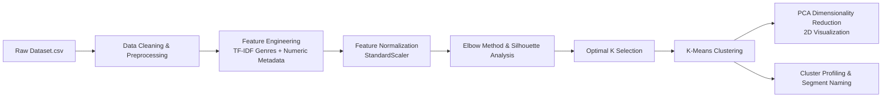

# 🧩 Task 4: Netflix Content Audience Segmentation

[](https://www.python.org/)
[](https://scikit-learn.org/)
[](https://pandas.pydata.org/)
[](#license)

An **Unsupervised Machine Learning** project that applies clustering algorithms to segment Netflix content into distinct audience groups based on metadata attributes — enabling smarter content categorization, personalization strategies, and catalog insight generation.

---

## 📌 Internship Portfolio & Task Navigation

This repository is part of my **Auspify AI / Machine Learning Internship**. All 4 internship tasks are organized within dedicated subdirectories:

| Task # | Task Title | Status |
| :---: | :--- | :---: |
| **Task 1** | Netflix Content Recommendation System | ✅ Completed |
| **Task 2** | Netflix Audience Rating Classification | ✅ Completed |
| **Task 3** | Netflix Viewership Trend Forecasting | ✅ Completed |
| **Task 4** | **Netflix Content Audience Segmentation** | ✅ Completed |

### 👤 Author & GitHub Profile
- **Developer**: **Muhammad Haseeb Ahmed**
- **Company**: **Auspify Technologies** (AI / ML Internship)
- **GitHub Profile**: [github.com/haseebahmed9814-design](https://github.com/haseebahmed9814-design)
- **Internship Repository**: [github.com/haseebahmed9814-design/Auspify-AI-Internship-Tasks](https://github.com/haseebahmed9814-design/Auspify-AI-Internship-Tasks)

---

## 📌 Project Overview

Netflix's content library spans thousands of titles across diverse genres, ratings, content types, and geographies. This task applies **unsupervised clustering** to group Netflix content into meaningful audience segments — revealing natural groupings in the catalog that can power smarter recommendation strategies, content acquisition decisions, and marketing targeting.

The pipeline covers:
- **Feature Engineering** for clustering: TF-IDF genre embeddings + normalized metadata features
- **Optimal Cluster Selection** using the Elbow Method and Silhouette Score Analysis
- **K-Means Clustering** for primary segmentation
- **Dimensionality Reduction** with PCA for 2D cluster visualization
- **Cluster Profiling**: Interpreting and naming each discovered audience segment

---

## 🚀 Key Features & Highlights

- **Hybrid Feature Matrix**: Combined TF-IDF vectorized genre text features with numerical metadata (duration, release year, content type, rating) into a unified normalized feature space.
- **Optimal K Selection**: Elbow curve and silhouette score analysis used to determine the ideal number of audience clusters.
- **K-Means Clustering**: Fast, scalable centroid-based clustering applied to the full 8,700+ title catalog.
- **PCA Visualization**: 2D scatter plots of cluster assignments after PCA dimensionality reduction for interpretability.
- **Cluster Profiling**: Dominant genres, rating distributions, content type breakdowns, and average duration computed per cluster for human-interpretable segment naming.
- **Segment Naming**: Each cluster labeled with a descriptive audience persona (e.g., "Family-Friendly Kids Content", "Mature International Dramas", "Short-Form Comedy & Reality").

---

## 📁 Repository Structure

```directory
Task_04/
├── Dataset.csv                           # Netflix titles raw metadata dataset (8,790 rows)
├── Task4_Segmentation.ipynb              # Complete Jupyter Notebook (EDA, Feature Engineering, Clustering, Profiling)
├── screenshots/                          # Step-by-step execution screenshots (10 images)
│   ├── Screenshot 2026-10-20 233014.png
│   └── ...
└── README.md                             # Project documentation
```

---

## 📸 Execution Proof & Visual Gallery

| Elbow Method - Optimal K | PCA Cluster Visualization |
| :---: | :---: |
|  |  |

| Cluster Genre Distribution | Silhouette Score Analysis |
| :---: | :---: |
|  |  |

---

## 📊 Workflow & Methodology



### 1. Feature Engineering for Clustering
| Feature Group | Encoding Method |
| :--- | :--- |
| Genres (`listed_in`) | TF-IDF Vectorization (sparse genre text) |
| Content Type | Binary encoding (Movie=1, TV Show=0) |
| Duration | Normalized minutes (Movies) / seasons (TV Shows) |
| Release Year | Min-Max normalized `release_year` |
| Rating | Ordinal encoded maturity level |

### 2. Optimal Cluster Selection
```python
# Elbow Method
inertias = []
for k in range(2, 15):
    km = KMeans(n_clusters=k, random_state=42, n_init=10)
    km.fit(X_scaled)
    inertias.append(km.inertia_)

# Silhouette Score
from sklearn.metrics import silhouette_score
sil_scores = [silhouette_score(X_scaled, km.labels_) for km in fitted_models]
```

### 3. Cluster Profiling
```python
# Profile each cluster
for cluster_id in range(optimal_k):
    cluster_data = df[df['cluster'] == cluster_id]
    print(f"\n=== Cluster {cluster_id} ===")
    print("Top Genres:", cluster_data['listed_in'].str.split(', ').explode().value_counts().head(5))
    print("Content Type:", cluster_data['type'].value_counts())
    print("Rating Distribution:", cluster_data['rating'].value_counts().head(5))
```

---

## 📈 Discovered Audience Segments

| Cluster | Segment Name | Key Characteristics |
| :---: | :--- | :--- |
| **0** | 🧒 Family & Kids Content | TV Shows, G/TV-Y ratings, short episodes, animation genres |
| **1** | 🌍 Mature International Dramas | Movies & TV Shows, TV-MA/R, international genres, long durations |
| **2** | 😂 Comedy & Light Entertainment | Mixed types, TV-PG/TV-14, stand-up comedy, reality shows |
| **3** | 🎬 Action & Thriller Block | Mostly Movies, TV-MA/R, action-adventure, crime genres |
| **4** | 📚 Documentary & Educational | Documentaries, all ratings, short/medium duration, global themes |

---

## ⚙️ Setup & Installation

1. **Navigate to directory**:
   ```bash
   cd Task_04
   ```

2. **Install Required Python Packages**:
   ```bash
   pip install pandas numpy scikit-learn matplotlib seaborn
   ```

3. **Launch Jupyter Notebook**:
   ```bash
   jupyter notebook Task4_Segmentation.ipynb
   ```

---

## 🔮 Future Enhancements

- [ ] **DBSCAN / HDBSCAN**: Explore density-based clustering for discovering outlier content and non-spherical clusters.
- [ ] **t-SNE Visualization**: Apply t-SNE alongside PCA for richer high-dimensional cluster visualization.
- [ ] **Personalized Recommendation Overlay**: Map user watch history into the cluster space for audience-segment-aware recommendations.

---

## 📜 License

Distributed under the MIT License. Feel free to use, modify, and distribute this project.
